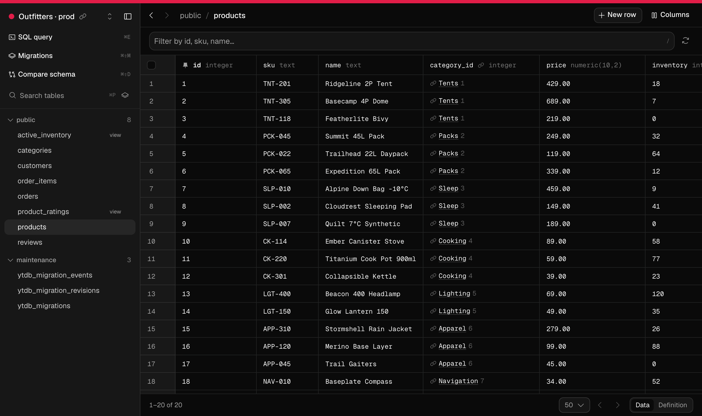
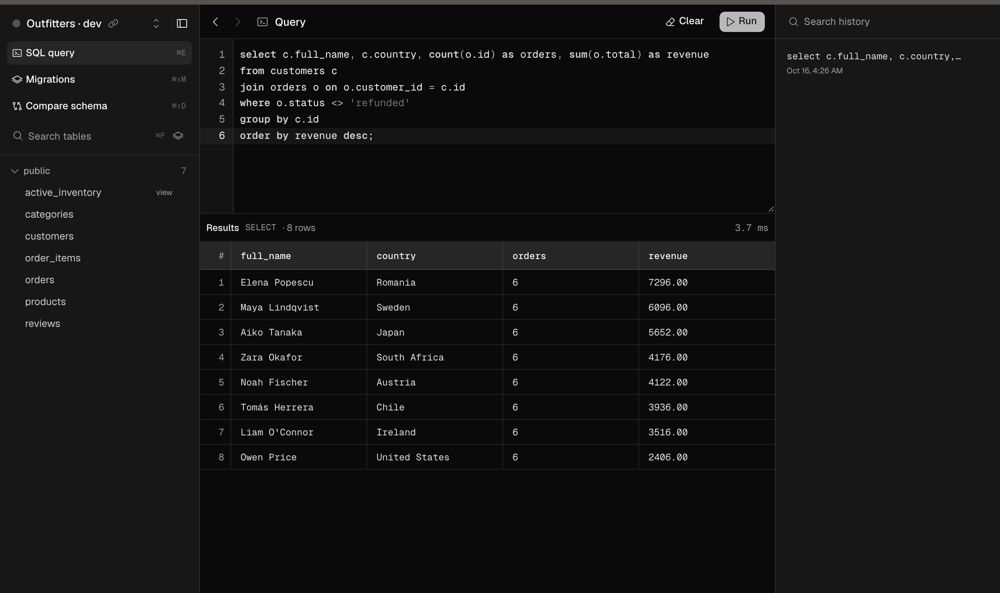
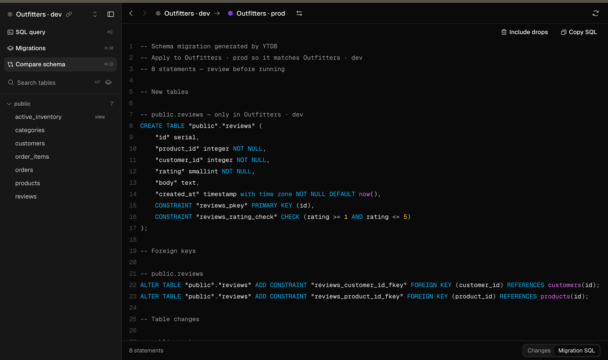

# YTDB

YTDB is a fast, local-first PostgreSQL browser for exploring and editing databases without leaving the keyboard. Run `npx @theobourgeois/ytdb` and it opens in your browser, with every query going through a small process on your own machine, so connection strings and data never leave it. You can browse and edit tables, follow foreign keys, run read-only SQL, compare two databases' schemas to generate the migration between them, and apply or revert a folder of migrations across environments.

