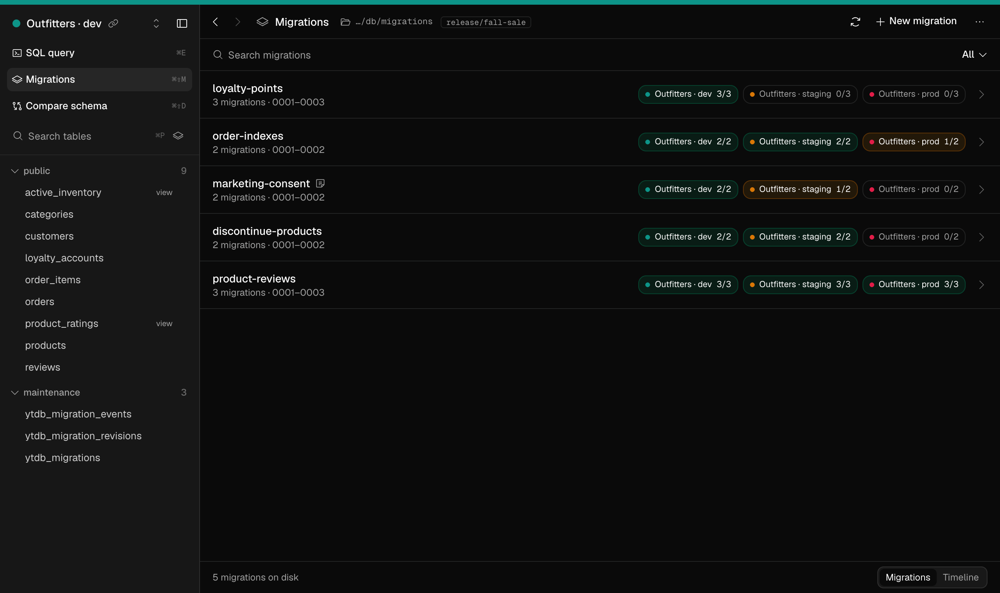
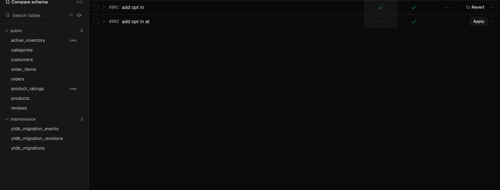
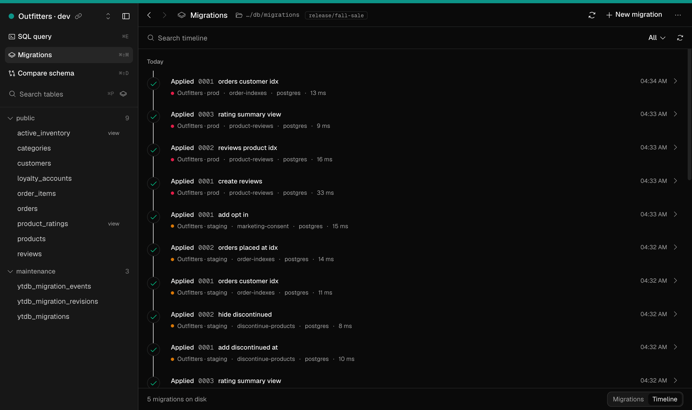

# YTDB

YTDB is a fast, local-first PostgreSQL browser and migration tool. Run `npx @theobourgeois/ytdb` and it opens in your browser, with every query going through a small process on your own machine, so connection strings and data never leave it. Point it at your repo's migrations folder and it shows where dev, staging and prod each stand on every migration, lets you apply or revert them one step at a time with notes for whoever runs them next, and keeps a timeline of every run in the database itself. Each environment gets its own color, so you always know whether you're about to touch prod. It also browses and edits tables, follows foreign keys, runs read-only SQL, and diffs two databases' schemas into migration SQL.

